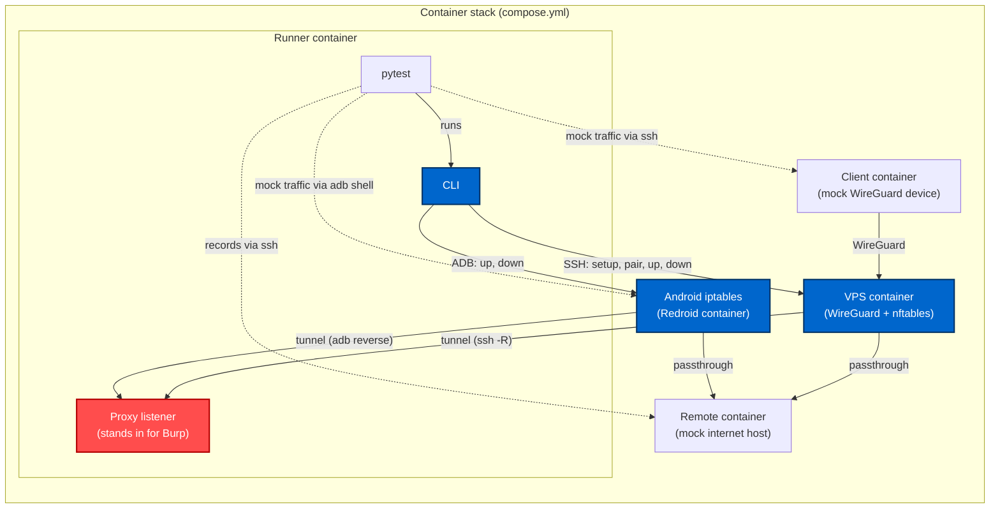

# Development

Development and packaging use [uv](https://docs.astral.sh/uv/).

```bash
uv sync
uv run ruff check .
uv run ruff format .
uv run pyright
uv run zizmor .
```

## Unit tests

Unit tests need no services. They check config parsing, the generated rulesets and the steps of each mode against mocked commands.

```bash
uv run pytest tests/unit
```

## Integration tests

Integration tests run the real CLI against a VPS, an Android device, a WireGuard client and a remote host.
[tests/integration/compose.yml](../tests/integration/compose.yml) simulates these external components as containers and runs `pytest` next to them.
A dev container cannot load the kernel modules they need, so they run on a Docker host with the modules below and nothing else.
Nothing is published or configured on it.
Outside this environment the integration tests skip, so `uv run pytest` runs the unit tests alone.

### Docker host

Redroid shares the host's kernel. These modules must be loaded on it.

```bash
sudo modprobe binder_linux devices=binder,hwbinder,vndbinder
sudo modprobe -a iptable_filter iptable_nat ip6table_filter ip6table_nat xt_owner xt_comment ipt_REJECT ip6t_REJECT
```

On Ubuntu they ship with `linux-modules-extra-$(uname -r)`. The tests never load modules.
Docker Desktop cannot run the stack. Its VM kernel has no binder and loads no modules. See [macOS](#macos).

### Running

```bash
export BINDER_MAJOR=$(awk '$2=="binder"{print $1}' /proc/devices)
docker compose -f tests/integration/compose.yml run --rm --build runner
docker compose -f tests/integration/compose.yml down -v
```

`BINDER_MAJOR` limits the Redroid container's device cgroup to the binder devices. Every compose command on this file needs it.
Arguments after `runner` replace the pytest command, for example `runner pytest tests/integration/test_adb_reverse.py -k lifecycle`.
CI runs the same commands. See [ci.yml](../.github/workflows/ci.yml).

### macOS

The stack runs in a Linux VM. [tests/integration/vm/Vagrantfile](../tests/integration/vm/Vagrantfile) defines one for Parallels Desktop.
This needs Parallels Desktop Pro or Business, [Vagrant](https://developer.hashicorp.com/vagrant/install) and the [vagrant-parallels](https://github.com/Parallels/vagrant-parallels) plugin.

```bash
vagrant plugin install vagrant-parallels
cd tests/integration/vm
vagrant up --no-destroy-on-error
vagrant provision
vagrant ssh
```

Inside the VM the repository is mounted at `/media/psf/vagrant`. Run the commands of [Running](#running) there.
`vagrant halt` stops the VM. `vagrant destroy` deletes it. [provision.sh](../tests/integration/vm/provision.sh) also prepares any other Ubuntu VM.

### Test environment



Blue is under test. That is the CLI and the gateway and device it configures. Everything else is a mock.
Solid arrows show what the CLI sets up and the paths traffic takes. Dashed arrows show the tests injecting traffic and reading records.

| Service | Role |
| --- | --- |
| `keys` | Generates the stack's SSH client key, host key and `known_hosts` into the `keys` volume and exits. |
| `runner` | Runs `pytest` and the CLI. The repository is copied in at build time. Hosts the proxy listeners on the tunnel ports. |
| `vps` | Ubuntu with systemd and sshd. The gateway of `wireguard_ssh_reverse`. |
| `client` | WireGuard client. The mobile device of `wireguard_ssh_reverse`. Sends all traffic through the gateway. |
| `redroid` | Rooted Android. The device of `adb_reverse`. Reached as `redroid:5555`. |
| `remote` | Host on the "internet". Answers `pong` on a few TCP and UDP ports and records sender and line. |

The runner reaches the VPS and Redroid by service name. It drives the client and remote over ssh with the keys of the `keys` volume and host key checking on.

### How traffic is mocked

Each test sends a line with a unique payload and checks where it ended up.
A tunneled line reaches the proxy listener. A passed line reaches the remote container. A rejected or dropped line reaches nothing.

In `wireguard_ssh_reverse` the client container applies the client config from `pair` and sends with bash over ssh.
All of its traffic enters the tunnel, except packets to the gateway's WireGuard port and replies to the runner.

In `adb_reverse` the device sends with `adb shell nc`.
Sent unelevated, a line is traffic of the ADB shell's package `com.android.shell`, the app in scope. Sent as root, it is traffic of another app.

### Test suites

| File | Covers |
| --- | --- |
| [test_wireguard_ssh_reverse.py](../tests/integration/test_wireguard_ssh_reverse.py) | `setup`, `pair`, `up`, `down`, each rule target, teardown of a failed `up`, a matrix of rules `nft` has to accept. |
| [test_adb_reverse.py](../tests/integration/test_adb_reverse.py) | `up`, `down`, each rule target, teardown of a failed `up`, a matrix of rules `iptables` has to accept. |
| [test_profile_jailed.py](../tests/integration/test_profile_jailed.py) | The `jailed` profile of the shipped [config.toml](../config.toml) with traffic of a WireGuard client. |
| [test_profile_rooted.py](../tests/integration/test_profile_rooted.py) | The `rooted` profile of the shipped [config.toml](../config.toml) with traffic of the Android device. |

The fixtures live in [conftest.py](../tests/integration/conftest.py).
