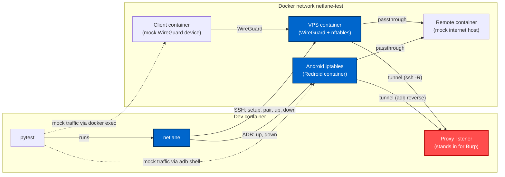

# Development

Development and packaging use [uv](https://docs.astral.sh/uv/).
The repository ships a [dev container](../.devcontainer/devcontainer.json) with everything the tests need (`uv`, `adb`, `wg`, `ssh` and access to the host's Docker).

```bash
uv sync
uv run black .
uv run pyright
```

## Unit tests

Unit tests need no services. They check config parsing, the generated rulesets and the steps of each mode against mocked commands.

```bash
uv run pytest tests/unit
```

## Integration tests

Integration tests run the real `netlane` command against containers that stand in for the VPS, the Android device and a host on the internet.

```bash
# Start the test containers
export BINDER_MAJOR=$(awk '$2=="binder"{print $1}' /proc/devices)
docker compose -f docker-compose.test.yml up -d

uv run pytest tests/integration

docker compose -f docker-compose.test.yml down
```

> [!NOTE]
> The `adb_reverse` integration tests run against a [Redroid](https://github.com/remote-android/redroid-doc) container, which needs these kernel modules loaded on the Docker host:
>
> ```bash
> sudo modprobe binder_linux devices=binder,hwbinder,vndbinder
> sudo modprobe -a iptable_filter iptable_nat ip6table_filter ip6table_nat xt_owner xt_comment ipt_REJECT ip6t_REJECT
> ```
>
> The container is not privileged. `BINDER_MAJOR` grants it access to the binder devices only, so it has to be set for every `docker compose` command on this file.

Tests whose container is not reachable are skipped. Set `NETLANE_TEST_REQUIRE_SERVICES=1` (as CI does) to make them fail instead.

### Test environment



Blue is what is under test: `netlane` and the gateway and device it configures. Everything else is a mock around it.
Solid arrows are what `netlane` sets up and the paths traffic takes, dashed arrows are the tests injecting mock traffic.

| Part | Role in the tests |
| --- | --- |
| Dev container | Runs `pytest`, which calls `netlane` exactly as an analyst would. Also hosts the listener on the tunnel port (e.g. `8080`), standing in for the analyst's proxy. |
| VPS container (`netlane-vps`) | Ubuntu with systemd and sshd, the gateway of `wireguard_ssh_reverse`. Reached over SSH on port `2222`. |
| Client container (`netlane-client`) | The mobile device of `wireguard_ssh_reverse`: a WireGuard client that sends all of its traffic through the gateway. |
| Redroid container (`netlane-redroid`) | Rooted Android, the device of `adb_reverse`. Reached over ADB on port `5555`. |
| Remote container (`netlane-remote`) | A host on the "internet". Answers `pong` on a few TCP/UDP ports and records what reached it and from which address. |

The test containers are siblings of the dev container on the host's Docker daemon, not children of it. The tests therefore reach the VPS and Redroid through their published ports, on `127.0.0.1` or `host.docker.internal`, whichever answers, and drive the client and remote containers with `docker exec`. Outside of a dev container (as in CI) the picture is the same, with `pytest` and `netlane` running directly on the host.

### How traffic is mocked

Each test sends a line with a unique payload and then checks where it ended up: at the proxy listener (tunnel), at the remote container (passthrough) or nowhere (reject/drop).

- **`wireguard_ssh_reverse`**: The client container stands in for the phone with the WireGuard app. The tests bring up the client config from `netlane pair` in it and send from it with `docker exec`. It reaches the gateway's WireGuard port over the test network and routes everything else through the tunnel, so no traffic can reach the remote container around the gateway.
- **`adb_reverse`**: The tests send from the device itself with `adb shell nc`. Sent unelevated, a line is traffic of the ADB shell's package (`com.android.shell`), which the tests use as the app in scope. Sent as root, it is traffic of another app.

### Test suites

| File | What it covers |
| --- | --- |
| [test_wireguard_ssh_reverse.py](../tests/integration/test_wireguard_ssh_reverse.py) | `setup`, `pair`, `up`, `down` and each rule target against the VPS container. Also the teardown of a failed `up` and a matrix of rules that `nft` has to accept. |
| [test_adb_reverse.py](../tests/integration/test_adb_reverse.py) | `up`, `down` and each rule target against the Redroid container. Also the teardown of a failed `up` and a matrix of rules that `iptables` has to accept. |
| [test_profile_jailed.py](../tests/integration/test_profile_jailed.py) | The `jailed` profile of the shipped [config.toml](../config.toml), with traffic of a WireGuard client. |
| [test_profile_rooted.py](../tests/integration/test_profile_rooted.py) | The `rooted` profile of the shipped [config.toml](../config.toml), with traffic of the Android device. |

The fixtures live in [conftest.py](../tests/integration/conftest.py).

### Using other targets

The tests find the containers on their own. These environment variables point them at something else, e.g. a real VPS or device:

| Variable | Default |
| --- | --- |
| `NETLANE_TEST_VPS_HOST` | auto-detected |
| `NETLANE_TEST_VPS_PORT` | `2222` |
| `NETLANE_TEST_VPS_USER` | `ubuntu` |
| `NETLANE_TEST_VPS_CONTAINER` | `netlane-vps` |
| `NETLANE_TEST_ADB_HOST` | auto-detected |
| `NETLANE_TEST_ADB_PORT` | `5555` |
| `NETLANE_TEST_ADB_ELEVATION` | `su` |
| `NETLANE_TEST_CLIENT_CONTAINER` | `netlane-client` |
| `NETLANE_TEST_REMOTE_CONTAINER` | `netlane-remote` |
